<div align="center">



<a href="https://git.io/typing-svg"></a>

<p>
  <a href="https://www.aionpartners.eu"></a>
  <a href="https://www.verticallm.ai"></a>
  
  
</p>

</div>

---

### 🏢 &nbsp;Where I build

<table align="center">
  <tr>
    <td align="center" width="25%">
      <a href="https://github.com/Aion-Partners"></a>
      <br/><b>Aion Partners</b>
      <br/><sub>Data architecture for institutional finance</sub>
    </td>
    <td align="center" width="25%">
      <a href="https://github.com/Verticallm"></a>
      <br/><b>Verticallm</b>
      <br/><sub>Supply chain strategy, delivered by AI</sub>
    </td>
    <td align="center" width="25%">
      <a href="https://github.com/tradeflow-so"></a>
      <br/><b>tradeflow.so</b>
      <br/><sub>Trading dashboard & trade replay</sub>
    </td>
    <td align="center" width="25%">
      <a href="https://github.com/Locally-ai-org"></a>
      <br/><b>Locally.ai</b>
      <br/><sub>Local-first AI for businesses</sub>
    </td>
  </tr>
</table>

---

### ⚡ &nbsp;Tech stack

<div align="center">

**Languages & frameworks**
<br/>


**Data, AI & infra**
<br/>


</div>

---

### 🧠 &nbsp;What I'm working on

```ts
const thomas = {
  building:   ["AION data platform", "Verticallm taxonomy engine", "TradeFlow trade replay", "Locally.ai"],
  focus:      ["data architecture", "agentic RAG", "forecasting", "market microstructure"],
  philosophy: "Your AI is only as strong as your data.",
  status:     "shipping 🚀",
};
```

---

<div align="center">


</div>
